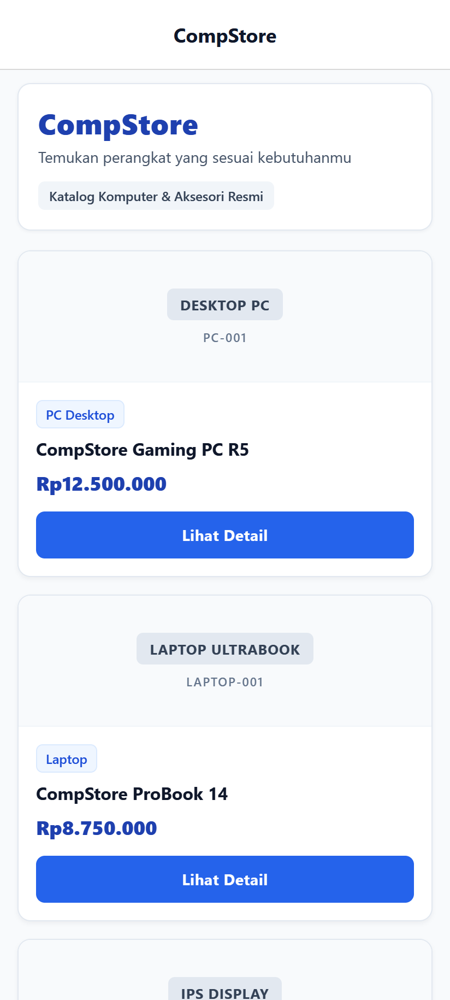
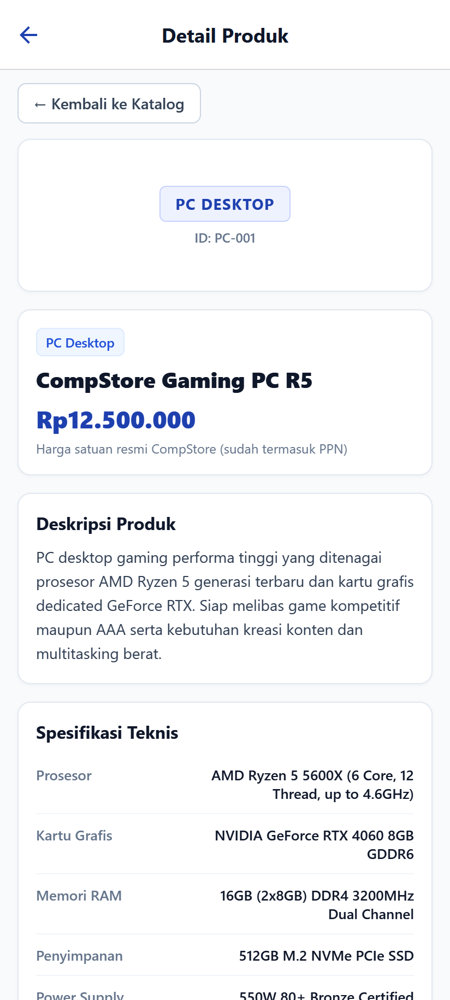
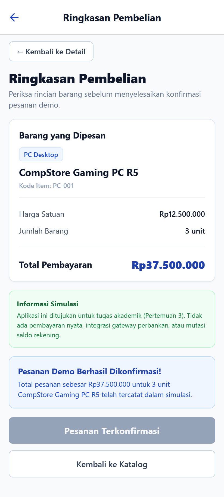
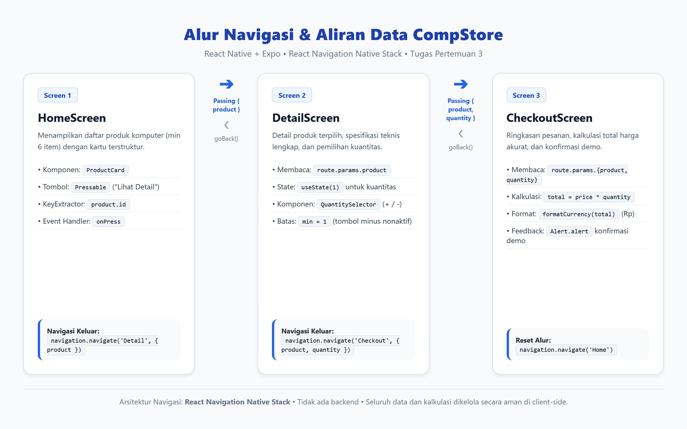

# CompStore: Aplikasi Mobile Katalog Komputer & Checkout

[](https://reactnative.dev/)
[](https://expo.dev/)
[](https://www.typescriptlang.org/)
[](https://reactnavigation.org/)

**CompStore** adalah aplikasi mobile katalog komputer dan simulasi checkout pemesanan yang dibangun menggunakan **React Native**, **Expo**, dan **TypeScript**. Proyek ini dikembangkan untuk memenuhi tugas akademik **Pertemuan 3 Pemrograman Mobile Lanjut**, dengan fokus pada implementasi interaksi pengguna (`Pressable`, `onPress`), Stack Navigation hierarkis, pengiriman data dinamis antar-layar (*passing data via route params*), pengelolaan *state* lokal (`useState`), serta kalkulasi nilai transaksi aktual.

---

## Tampilan Antarmuka Aplikasi (Screenshots)

Berikut adalah tangkapan layar langsung (*actual running app*) dari ketiga layar utama dan diagram alur navigasi:

| 1. Home Screen (Katalog) | 2. Detail Screen (Spesifikasi) | 3. Checkout Screen (Ringkasan) |
| :---: | :---: | :---: |
|  |  |  |
| *Daftar 6 produk komputer resmi dengan format Rupiah* | *Detail spesifikasi teknis & kontrol kuantitas dinamis* | *Kalkulasi otomatis total bayar & konfirmasi demo* |

---

### Diagram Arsitektur & Alur Navigasi Data

Alur perpindahan layar dan pertukaran parameter navigasi antar-halaman:

<p align="center">
  
</p>

---

## Fitur Utama & Layar Aplikasi

1. **Home Screen (Katalog Produk):**
   - Header aplikasi "CompStore" dengan subjudul deskriptif.
   - Katalog produk terpusat berisi 6 kategori perangkat komputer: Gaming PC, Laptop, Monitor IPS, Mechanical Keyboard, Gaming Mouse, dan NVMe SSD.
   - Kartu produk (`ProductCard`) menampilkan kategori, nama perangkat, harga berformat Rupiah, dan tombol interaktif "Lihat Detail".
   - Menggunakan `FlatList` dengan `keyExtractor` unik berbasis `product.id`.
   - Penanganan *empty state* yang ramah jika katalog kosong.

2. **Detail Screen (Detail Produk):**
   - Informasi lengkap produk yang dipilih secara dinamis (tanpa data *hardcoded*).
   - Tabel rincian spesifikasi teknis perangkat yang relevan dengan kategorinya.
   - Kontrol pemilihan kuantitas (`QuantitySelector`) interaktif berbasis `useState`.
   - Tombol penambahan (`+`) dan pengurangan (`−`) dengan batas minimal 1 (tombol minus nonaktif saat kuantitas = 1).
   - Estimasi subtotal harga yang berubah secara *real-time* saat kuantitas diubah.
   - Tombol navigasi "← Kembali ke Katalog" menggunakan `navigation.goBack()`.
   - Tombol "Beli Sekarang" untuk meneruskan data produk dan kuantitas ke layar checkout.

3. **Checkout Screen (Ringkasan Pembelian):**
   - Rincian produk yang dipesan beserta kuantitas barang dari `route.params`.
   - Kalkulasi otomatis total pembayaran (`total = hargaSatuan × jumlah`).
   - Tombol "Konfirmasi Pembelian" dengan umpan balik dialog *feedback* dan banner konfirmasi.
   - Proteksi aksi konfirmasi ganda (*disabled button after confirmation*).
   - Tombol navigasi kembali ke detail (`navigation.goBack()`) dan tombol "Kembali ke Katalog" (`navigation.navigate('Home')`).

---

## Implementasi Konsep Akademik

| Konsep Materi | Penerapan dalam Source Code |
| :--- | :--- |
| **Pressable & onPress** | Digunakan pada tombol "Lihat Detail", tombol tambah/kurang kuantitas, tombol "Beli Sekarang", "Konfirmasi Pembelian", dan seluruh tombol kembali. |
| **Stack Navigation** | Konfigurasi `createNativeStackNavigator` di `src/navigation/AppNavigator.tsx` mendaftarkan layar `Home`, `Detail`, dan `Checkout`. |
| **navigation.navigate()** | Berpindah dari `Home` ke `Detail` membawa `{ product }`, dan dari `Detail` ke `Checkout` membawa `{ product, quantity }`. |
| **navigation.goBack()** | Tombol navigasi kembali dari `Detail` → `Home` dan `Checkout` → `Detail`. |
| **route.params** | Membaca parameter data pada layar penerima dengan validasi runtime dan tipe data TypeScript yang ketat. |
| **useState** | Mengelola kuantitas pesanan secara lokal dan reaktif pada layar detail. |
| **User Feedback** | Dialog `Alert.alert` dan banner UI konfirmasi saat pesanan demo dikonfirmasi. |

---

## Dependensi Utama

- `expo` (`~58.0.13`)
- `react` (`19.3.0`)
- `react-native` (`0.88.0`)
- `@react-navigation/native` (`^7.5.1`)
- `@react-navigation/native-stack` (`^7.21.0`)
- `react-native-screens` (`~4.30.0`)
- `react-native-safe-area-context` (`~5.10.1`)
- `expo-status-bar` (`~58.0.3`)

---

## Langkah Menjalankan Proyek

### 1. Instalasi Dependensi
```bash
npm install
```

### 2. Menjalankan Server Expo
```bash
# Menjalankan Expo development server (untuk scan via Expo Go di ponsel)
npm start

# Atau menjalankan langsung di HP Android terhubung via USB / Emulator
npm run android

# Atau menjalankan pada Web browser
npm run web
```

---

## Catatan Batasan Aplikasi

> [!NOTE]
> Aplikasi ini adalah **simulasi katalog dan checkout untuk keperluan akademik (Pertemuan 3)**. Aplikasi ini tidak menggunakan backend server, tidak menyimpan data kartu kredit/rekening, dan tidak melakukan transaksi perbankan sungguhan.

---

## Struktur Folder Proyek

```
CompStore/
├── assets/                  # Aset aplikasi (ikon dan splash)
├── scripts/                 # Skrip automasi pengujian dan tangkapan layar
├── src/
│   ├── components/          # Komponen UI modular
│   │   ├── ProductCard.tsx
│   │   └── QuantitySelector.tsx
│   ├── data/                # Sumber data produk terpusat
│   │   └── products.ts
│   ├── navigation/          # Konfigurasi Stack Navigator
│   │   └── AppNavigator.tsx
│   ├── screens/             # Tampilan layar aplikasi
│   │   ├── HomeScreen.tsx
│   │   ├── DetailScreen.tsx
│   │   └── CheckoutScreen.tsx
│   ├── types/               # Tipe data TypeScript dan navigasi
│   │   ├── product.ts
│   │   └── navigation.ts
│   └── utils/               # Fungsi pembantu format Rupiah
│       └── formatCurrency.ts
├── submission/              # Berkas pengumpulan tugas
│   ├── screenshots/         # Tangkapan layar aktual (01-04)
│   └── dokumentasi.md       # Laporan dokumentasi lengkap
├── App.tsx                  # Entri utama aplikasi
├── app.json                 # Konfigurasi Expo
├── package.json             # Manifest dependensi & script
├── tsconfig.json            # Konfigurasi TypeScript
├── README.md                # Panduan proyek & tampilan GitHub
└── REQ.md                   # Dokumen spesifikasi tugas
```
"# pemobilelanjut-p3" 
